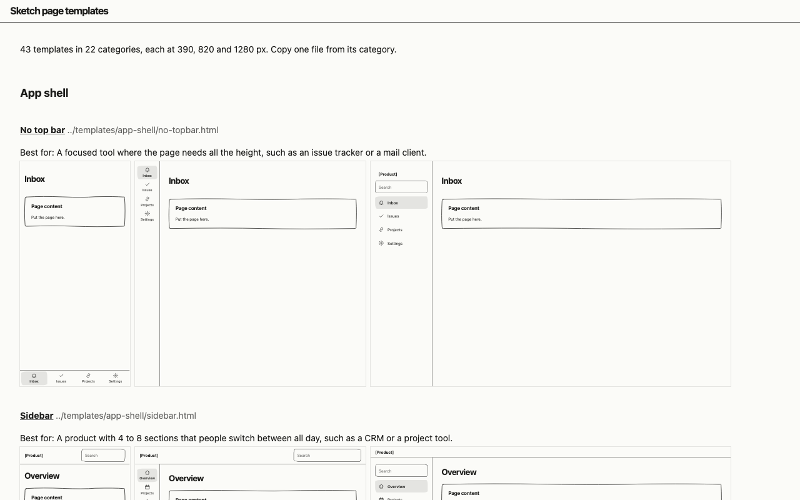

# sketch-skill

[](LICENSE)

`asabirov/sketch-skill`: Agent skill for disposable one-ink UI sketches.

The agent draws a page with one marker. The page shows layout and behaviour, and nobody can mistake it for the finished product.



## Install

Install the latest version:

```sh
DO_NOT_TRACK=1 npx skills add https://github.com/asabirov/sketch-skill --skill sketch --agent claude-code codex --global -y
```

Update it later:

```sh
DO_NOT_TRACK=1 npx skills update sketch --global
```

`DO_NOT_TRACK=1` turns off the telemetry of the skills CLI. The CLI needs Node.js, npm and Git. `assets/sketch_inline.py` needs Python 3.

Then ask your agent to sketch a screen.

## Why it exists

An early mockup that looks finished gets feedback about colours and fonts. A sketch keeps the review on layout and behaviour. One ink, no design tokens and a fixed kit make that difference visible.

| Candidate | Why not |
| --- | --- |
| A visual design system | A sketch must not look like a product. No sketch value is a design token |
| A framework or a drawing library | A sketch is one plain HTML file that opens anywhere |

## How it works

1. The agent chooses a category and starts from one of its 48 templates.
2. The kit in `assets/` gives the marks, controls, themes and focus states.
3. The agent changes the template words and rows for the screen.

## What's where

| Path | Holds |
| --- | --- |
| `SKILL.md` | The entry point |
| `references/` | The sketch rules |
| `assets/` | The kit and the template gallery |
| `templates/` | The categorized template library |
| `library/` | Reusable pattern records and sketches, listed in [`docs/library.md`](docs/library.md) |

## Template categories

| Category | Templates | Best for |
| --- | ---: | --- |
| App shell | 3 | Product navigation |
| Home | 3 | Starting a task |
| Conversation | 3 | Chat screens |
| List | 5 | Browsing items |
| Catalog | 1 | Browsing add-ons |
| Projects | 1 | Opening workspaces |
| Project | 1 | Viewing one workspace |
| Search | 2 | Finding product content |
| Menu | 1 | Account actions |
| Settings | 8 | Product preferences |
| Landing | 1 | A public product page |
| Notes | 2 | Writing and reading items |
| Detail | 1 | Viewing one record |
| Form | 1 | Completing one form |
| Dashboard | 1 | Viewing key metrics |
| Chart | 5 | Showing values over time |
| Board | 1 | Moving items by stage |
| Checkout | 1 | Completing a purchase |
| Pricing | 1 | Comparing plans |
| Sign in | 1 | Signing in |
| Onboarding | 3 | Setting up a product |
| Empty | 1 | Showing no data |
| Mobile | 1 | Phone navigation |

## Pattern library

The library has 68 patterns in 8 categories. Each pattern holds a record, its transitions and a sketch. See each pattern and its "Best for" line in [`docs/library.md`](docs/library.md).

| Category | Patterns | Holds |
| --- | ---: | --- |
| Account | 5 | Sign-up, waitlist, OAuth consent, connected apps |
| Chat | 14 | Chat list, conversation pane, create a chat, voice message, avatar badges, app in a chat |
| Content | 20 | Feeds, catalog views, comment threads, fact cards, forum list, kanban, timeline, product page, leaderboard |
| Navigation | 8 | User menu, foot menu, topics tree, swipe back |
| Notifications | 5 | Notification inbox, inbox popover, activity feed, follow menu, subscribe popover |
| Profile | 4 | Member profile, portfolio profile, profile card, character builder |
| Settings | 6 | Settings window, settings modal, notification settings by event and by channel, theme switch, phone settings page |
| Sheets | 6 | Bottom sheets, catalogue sheets |

## Run and verify

Open `assets/sketch-pages.html` in a browser to see the template gallery. See a picture of each template in [`docs/templates.md`](docs/templates.md).

A pull request gate checks each file under `library/` for a Source note or a web address. A name check runs in a private flow before a pattern reaches this repository. The repository keeps no name or hash list.

## Licence

Apache License 2.0. See `LICENSE`.
