# Templates

The skill has 43 page templates in 22 categories. Copy the file at the path of an entry to start a sketch. A click on a picture opens it at its full size.

Run `python3 docs/render.py` from the repository root to refresh these pictures after a template changes. It needs Python 3 with Pillow and the `agent-browser` CLI.

[App shell](#app-shell), [Home](#home), [Conversation](#conversation), [List](#list), [Catalog](#catalog), [Projects](#projects), [Project](#project), [Search](#search), [Menu](#menu), [Settings](#settings), [Landing](#landing), [Notes](#notes), [Detail](#detail), [Form](#form), [Dashboard](#dashboard), [Board](#board), [Checkout](#checkout), [Pricing](#pricing), [Sign in](#sign-in), [Onboarding](#onboarding), [Empty](#empty), [Mobile](#mobile)

## App shell

<table>
<tr>
<td width="460"><a href="templates/app-shell/no-topbar.png">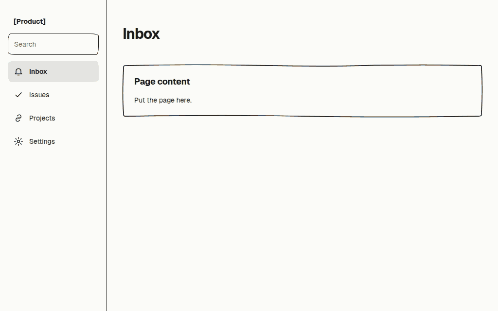</a></td>
<td><b>No top bar</b> A focused tool where the page needs all the height, such as an issue tracker or a mail client. <a href="../templates/app-shell/no-topbar.html"><code>templates/app-shell/no-topbar.html</code></a></td>
</tr>
<tr>
<td width="460"><a href="templates/app-shell/sidebar.png">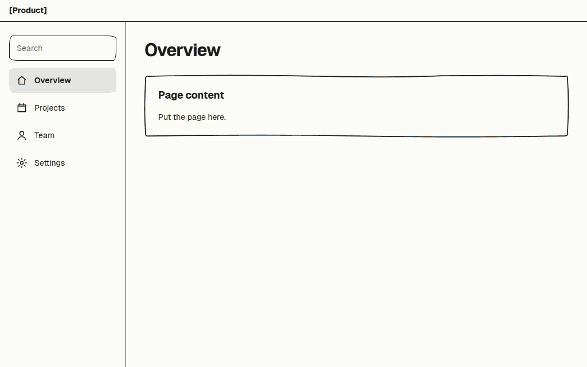</a></td>
<td><b>Sidebar</b> A product with 4 to 8 sections that people switch between all day, such as a CRM or a project tool. <a href="../templates/app-shell/sidebar.html"><code>templates/app-shell/sidebar.html</code></a></td>
</tr>
<tr>
<td width="460"><a href="templates/app-shell/topbar.png">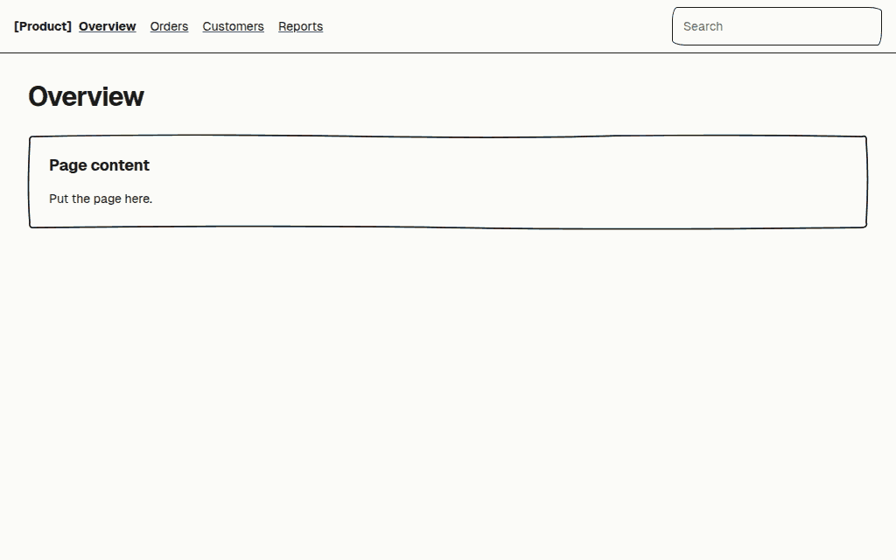</a></td>
<td><b>Top bar</b> A product with 3 to 5 sections and wide pages, such as a store admin or an analytics tool. <a href="../templates/app-shell/topbar.html"><code>templates/app-shell/topbar.html</code></a></td>
</tr>
</table>

## Home

<table>
<tr>
<td width="460"><a href="templates/home/composer-centred.png">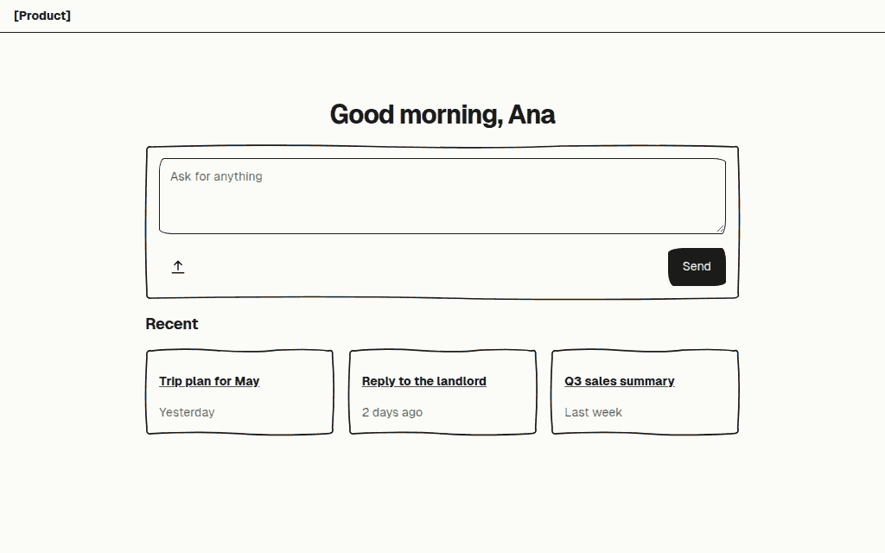</a></td>
<td><b>Composer-centred</b> The first page of an assistant or a search tool, where people start by typing one request. <a href="../templates/home/composer-centred.html"><code>templates/home/composer-centred.html</code></a></td>
</tr>
<tr>
<td width="460"><a href="templates/home/onboarding-hint.png">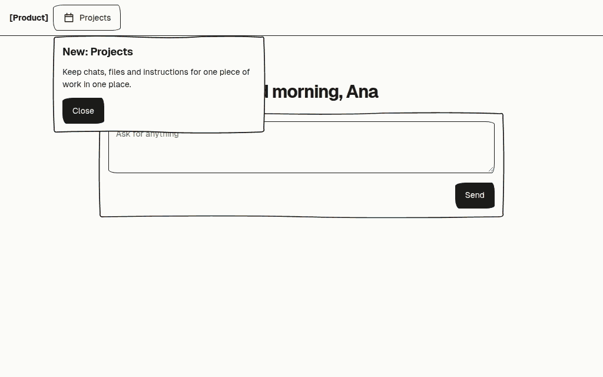</a></td>
<td><b>Onboarding hint</b> A first page that points to one new control with a small hint. <a href="../templates/home/onboarding-hint.html"><code>templates/home/onboarding-hint.html</code></a></td>
</tr>
<tr>
<td width="460"><a href="templates/home/session-start.png">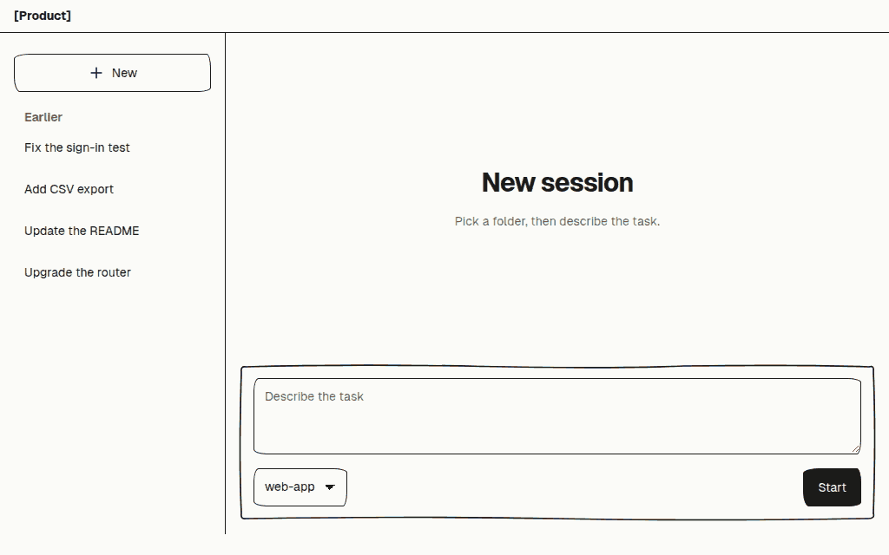</a></td>
<td><b>Session start</b> A tool where people start a new work session from a list of earlier sessions. <a href="../templates/home/session-start.html"><code>templates/home/session-start.html</code></a></td>
</tr>
</table>

## Conversation

<table>
<tr>
<td width="460"><a href="templates/conversation/channels.png">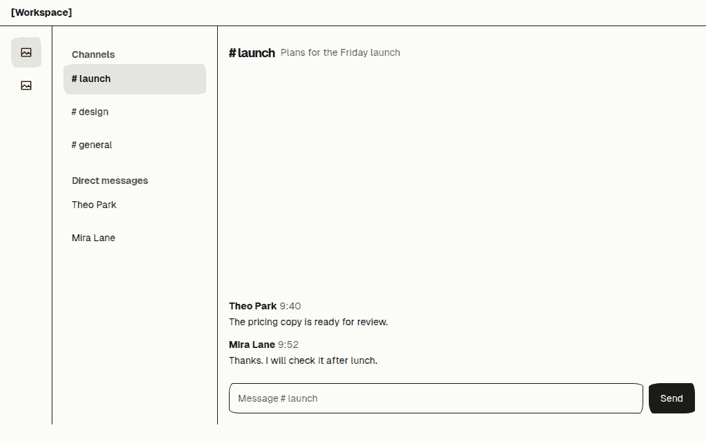</a></td>
<td><b>Channels</b> A team chat with many workspaces and channels, with a list of channels at the left of the messages. <a href="../templates/conversation/channels.html"><code>templates/conversation/channels.html</code></a></td>
</tr>
<tr>
<td width="460"><a href="templates/conversation/split-with-preview.png">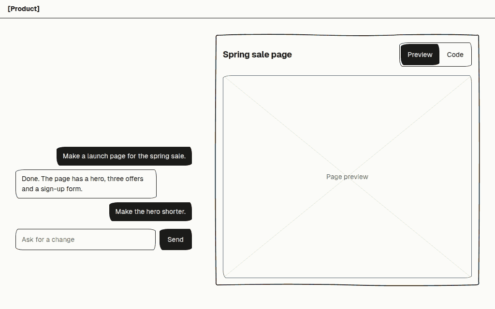</a></td>
<td><b>Split with preview</b> A chat that makes a document, a page or code, and shows it large beside the messages. <a href="../templates/conversation/split-with-preview.html"><code>templates/conversation/split-with-preview.html</code></a></td>
</tr>
<tr>
<td width="460"><a href="templates/conversation/with-side-panel.png">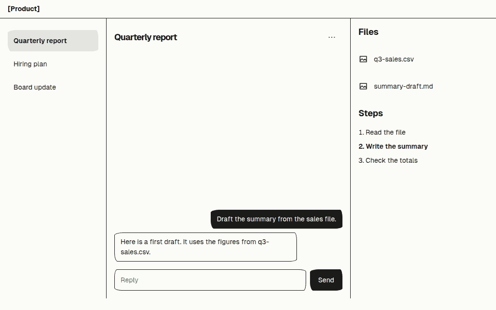</a></td>
<td><b>With side panel</b> A chat that shows files, steps or details in a narrow panel at the right. <a href="../templates/conversation/with-side-panel.html"><code>templates/conversation/with-side-panel.html</code></a></td>
</tr>
</table>

## List

<table>
<tr>
<td width="460"><a href="templates/list/card-grid.png">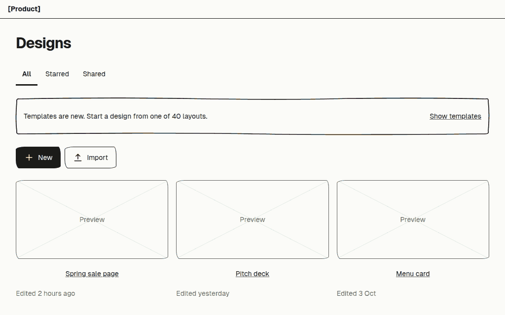</a></td>
<td><b>Card grid</b> Items that people find by their picture, such as designs, files or templates. <a href="../templates/list/card-grid.html"><code>templates/list/card-grid.html</code></a></td>
</tr>
<tr>
<td width="460"><a href="templates/list/empty-with-suggestions.png">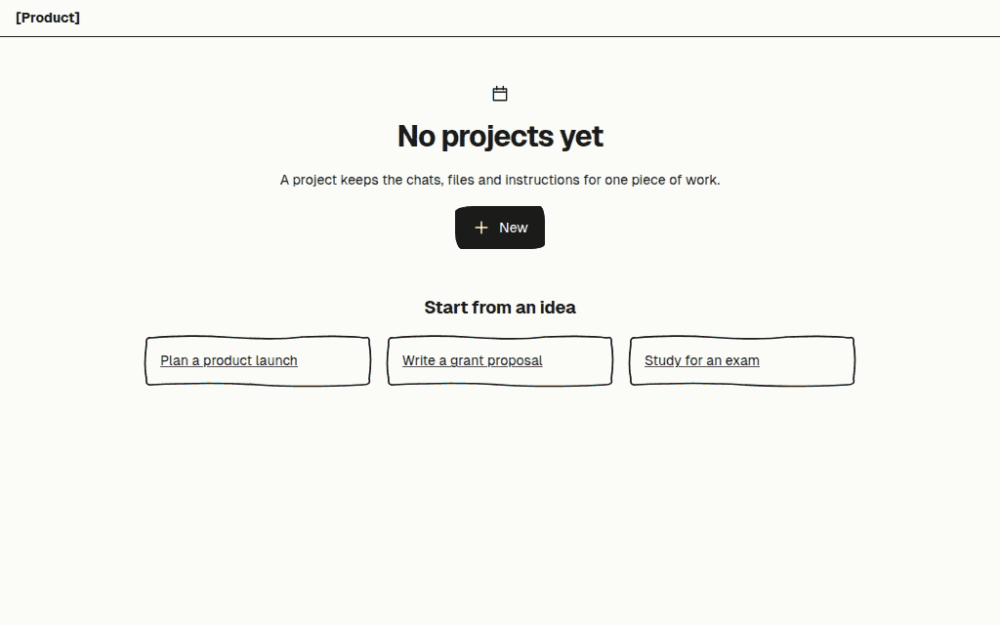</a></td>
<td><b>Empty with suggestions</b> A list that has no items yet, with ideas that help people make the first one. <a href="../templates/list/empty-with-suggestions.html"><code>templates/list/empty-with-suggestions.html</code></a></td>
</tr>
<tr>
<td width="460"><a href="templates/list/empty.png">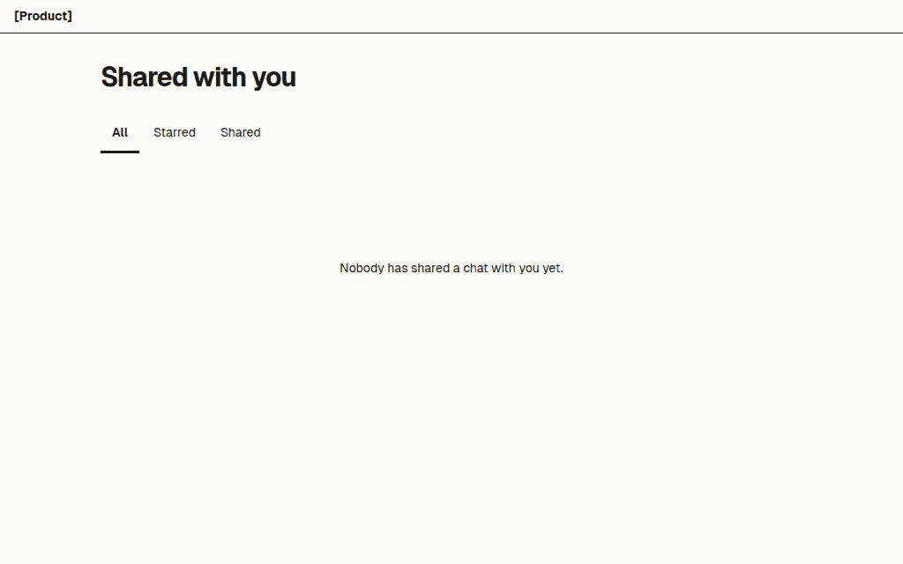</a></td>
<td><b>Empty</b> A list that has no items yet and needs no action. <a href="../templates/list/empty.html"><code>templates/list/empty.html</code></a></td>
</tr>
<tr>
<td width="460"><a href="templates/list/rows-with-tabs.png">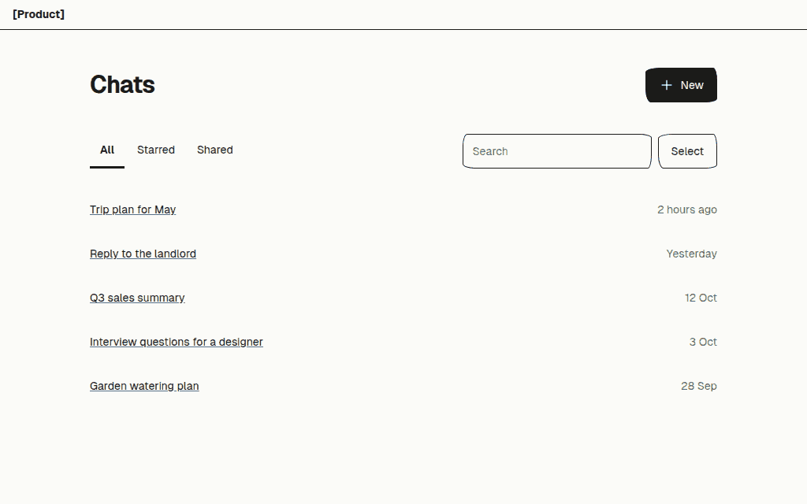</a></td>
<td><b>Rows with tabs</b> A long list of items with a title and a date, such as chats, notes or orders. <a href="../templates/list/rows-with-tabs.html"><code>templates/list/rows-with-tabs.html</code></a></td>
</tr>
<tr>
<td width="460"><a href="templates/list/table.png">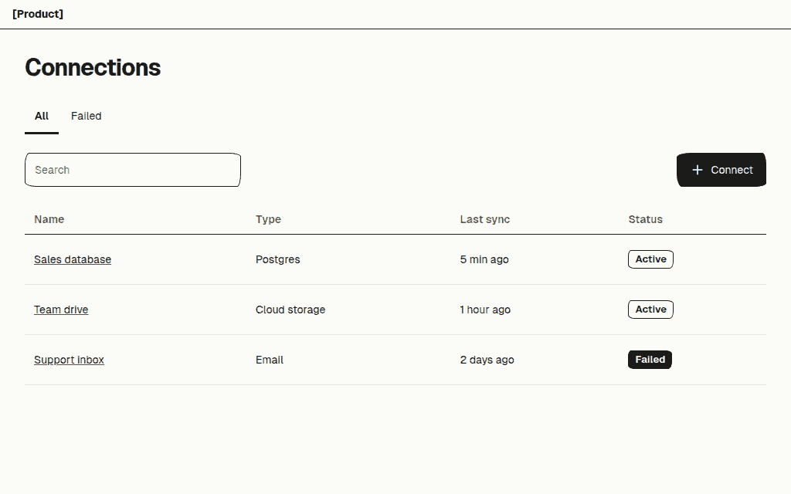</a></td>
<td><b>Table</b> Items with many fields and a status, such as connections, users or invoices. <a href="../templates/list/table.html"><code>templates/list/table.html</code></a></td>
</tr>
</table>

## Catalog

<table>
<tr>
<td width="460"><a href="templates/catalog/discover.png">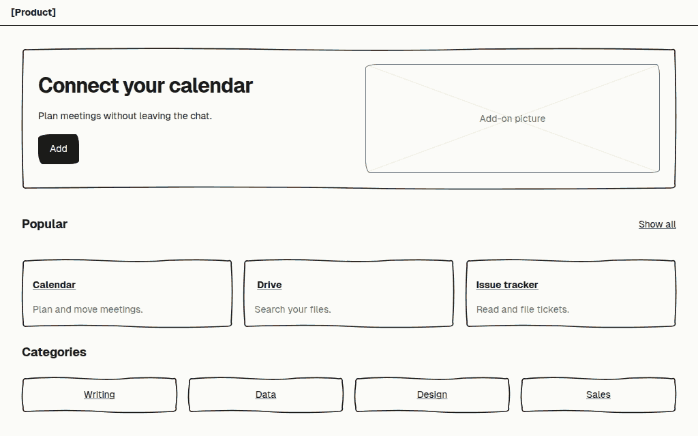</a></td>
<td><b>Discover</b> A store of add-ons or templates that people browse by category. <a href="../templates/catalog/discover.html"><code>templates/catalog/discover.html</code></a></td>
</tr>
</table>

## Projects

<table>
<tr>
<td width="460"><a href="templates/projects/index.png">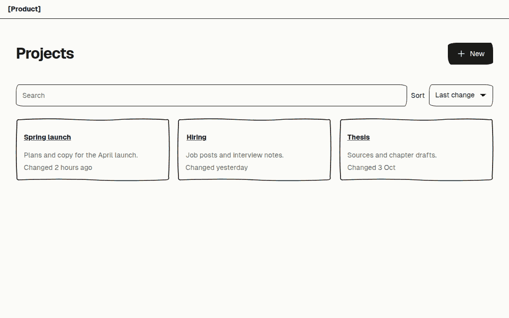</a></td>
<td><b>Index</b> A small set of workspaces that people open by name. <a href="../templates/projects/index.html"><code>templates/projects/index.html</code></a></td>
</tr>
</table>

## Project

<table>
<tr>
<td width="460"><a href="templates/project/detail.png">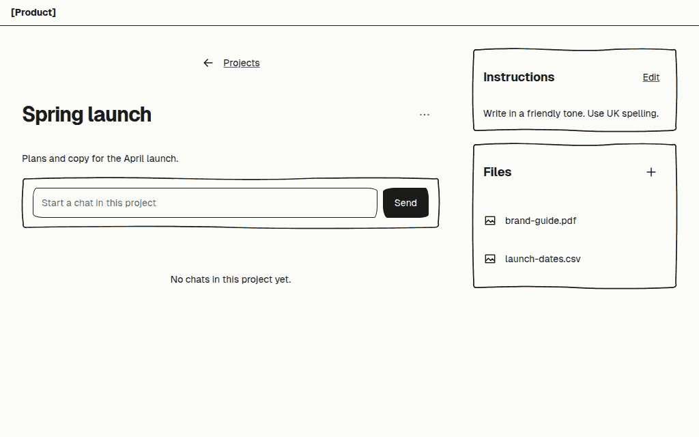</a></td>
<td><b>Detail</b> One workspace with its own files, instructions and recent work. <a href="../templates/project/detail.html"><code>templates/project/detail.html</code></a></td>
</tr>
</table>

## Search

<table>
<tr>
<td width="460"><a href="templates/search/command-palette.png">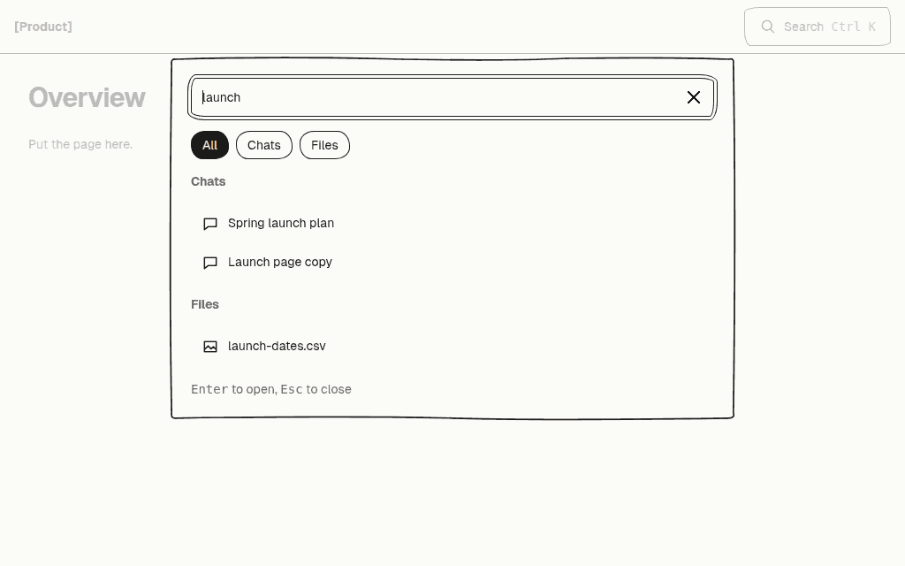</a></td>
<td><b>Command palette</b> A search over the whole product that opens from a key shortcut. <a href="../templates/search/command-palette.html"><code>templates/search/command-palette.html</code></a></td>
</tr>
<tr>
<td width="460"><a href="templates/search/results.png">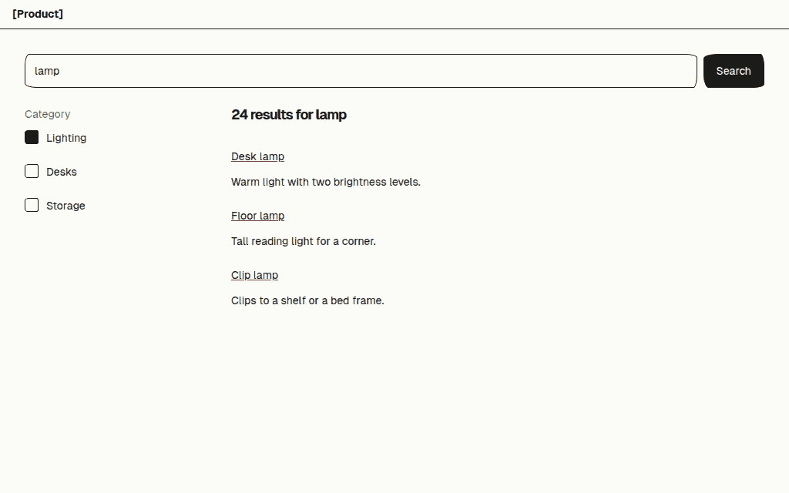</a></td>
<td><b>Results</b> A search over many items, with filters at the left and a list of results. <a href="../templates/search/results.html"><code>templates/search/results.html</code></a></td>
</tr>
</table>

## Menu

<table>
<tr>
<td width="460"><a href="templates/menu/account.png">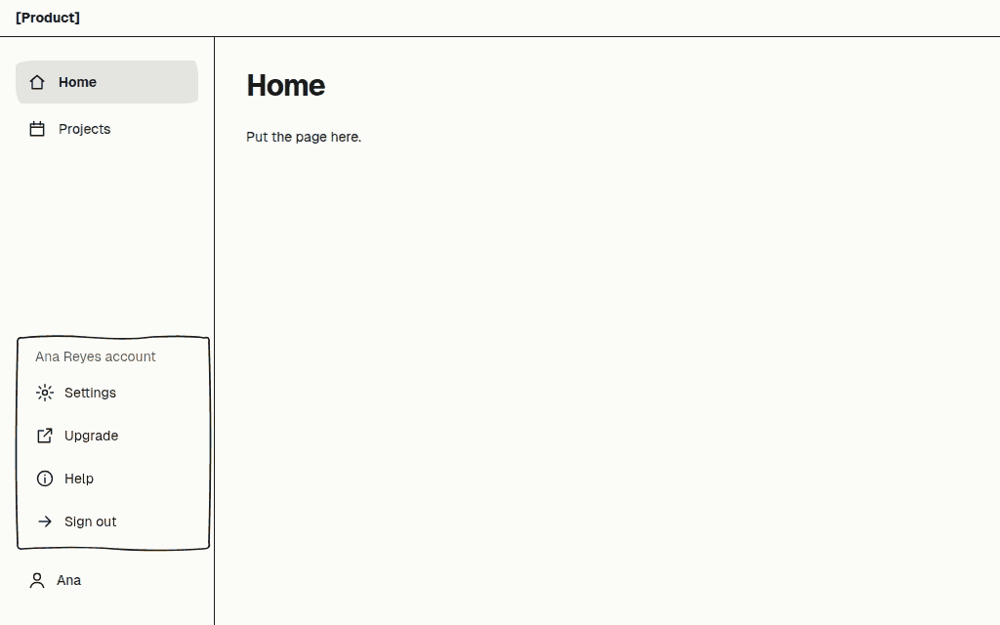</a></td>
<td><b>Account</b> The account, plan and sign-out actions that open from the user's name. <a href="../templates/menu/account.html"><code>templates/menu/account.html</code></a></td>
</tr>
</table>

## Settings

<table>
<tr>
<td width="460"><a href="templates/settings/form.png">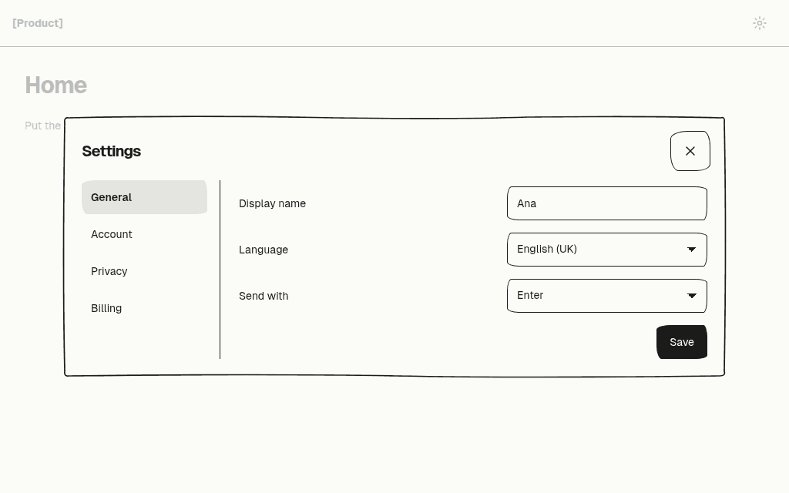</a></td>
<td><b>Form</b> Settings in groups, with a list of groups at the left. <a href="../templates/settings/form.html"><code>templates/settings/form.html</code></a></td>
</tr>
<tr>
<td width="460"><a href="templates/settings/icon-grid.png">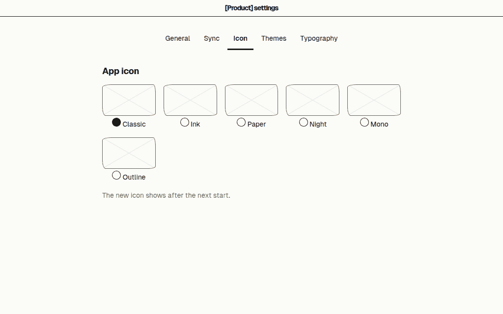</a></td>
<td><b>Icon grid</b> A choice of one app icon or picture from a grid of small tiles. <a href="../templates/settings/icon-grid.html"><code>templates/settings/icon-grid.html</code></a></td>
</tr>
<tr>
<td width="460"><a href="templates/settings/option-form.png">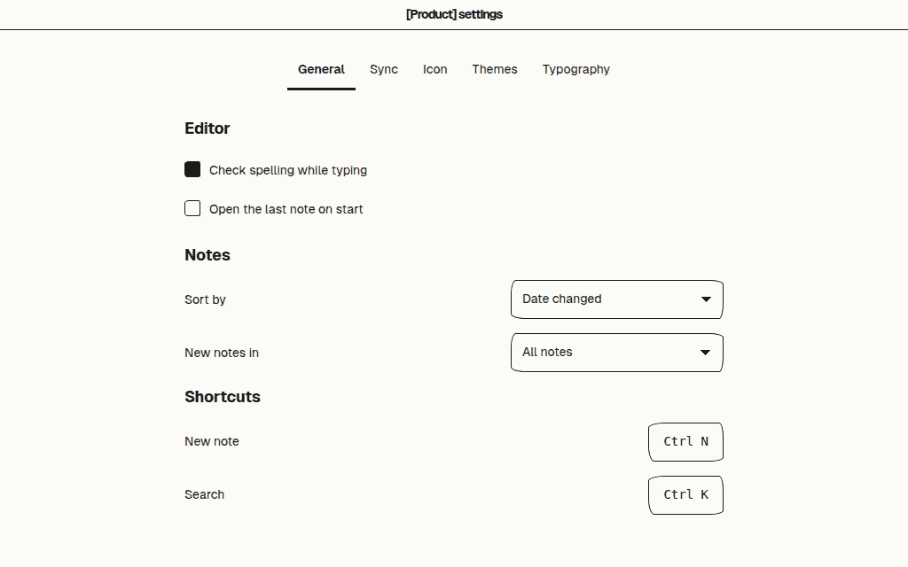</a></td>
<td><b>Option form</b> Settings in sections with checkboxes, menus and key shortcuts, in a window with tabs. <a href="../templates/settings/option-form.html"><code>templates/settings/option-form.html</code></a></td>
</tr>
<tr>
<td width="460"><a href="templates/settings/sliders.png">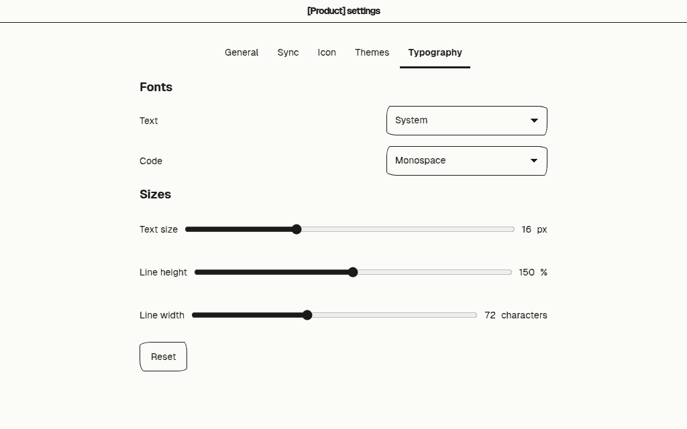</a></td>
<td><b>Sliders</b> Values that people set on a scale, such as text size, line height or volume. <a href="../templates/settings/sliders.html"><code>templates/settings/sliders.html</code></a></td>
</tr>
<tr>
<td width="460"><a href="templates/settings/sync-status.png">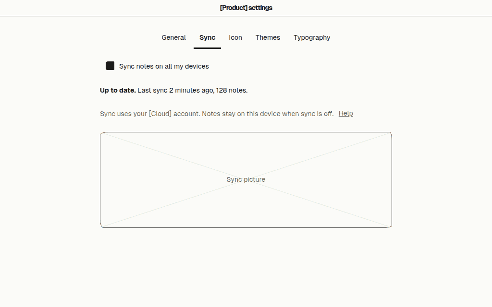</a></td>
<td><b>Sync status</b> A service that keeps data the same on all devices, with its state and one switch. <a href="../templates/settings/sync-status.html"><code>templates/settings/sync-status.html</code></a></td>
</tr>
<tr>
<td width="460"><a href="templates/settings/theme-picker.png">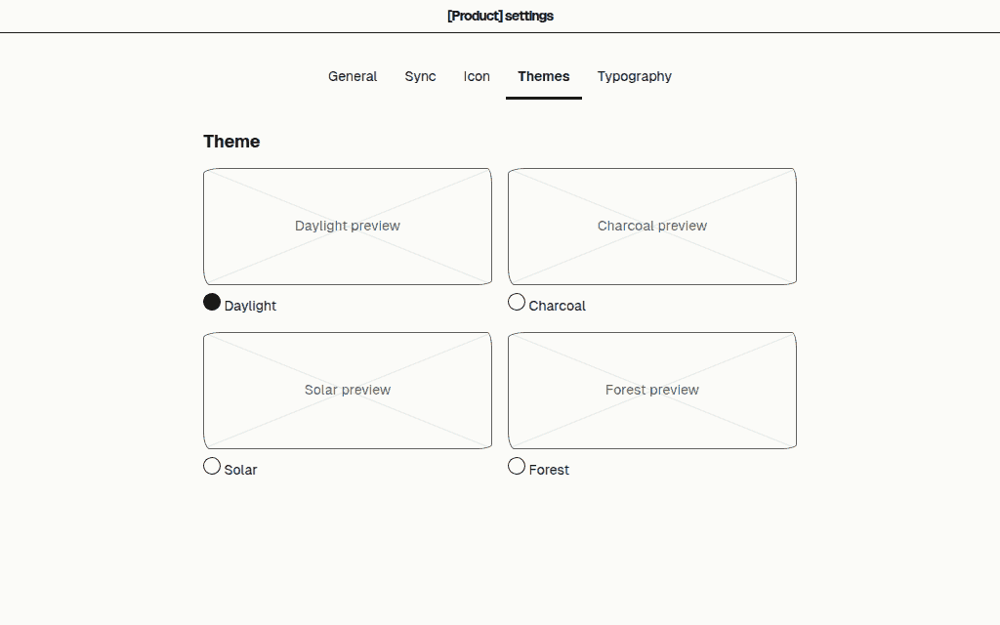</a></td>
<td><b>Theme picker</b> A choice of one colour theme from a grid of preview cards. <a href="../templates/settings/theme-picker.html"><code>templates/settings/theme-picker.html</code></a></td>
</tr>
<tr>
<td width="460"><a href="templates/settings/toggles.png">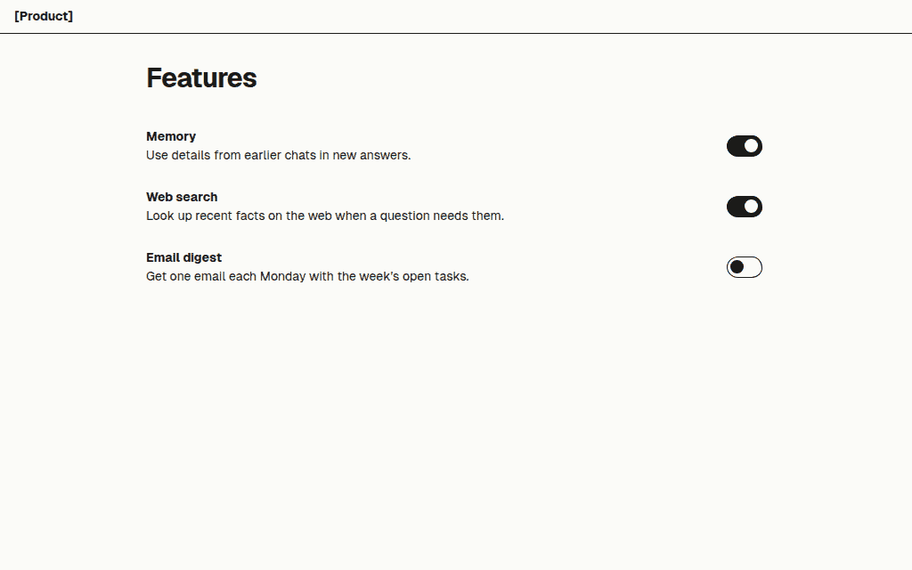</a></td>
<td><b>Toggles</b> Features that people turn on or off, each with one sentence about it. <a href="../templates/settings/toggles.html"><code>templates/settings/toggles.html</code></a></td>
</tr>
<tr>
<td width="460"><a href="templates/settings/usage-meters.png">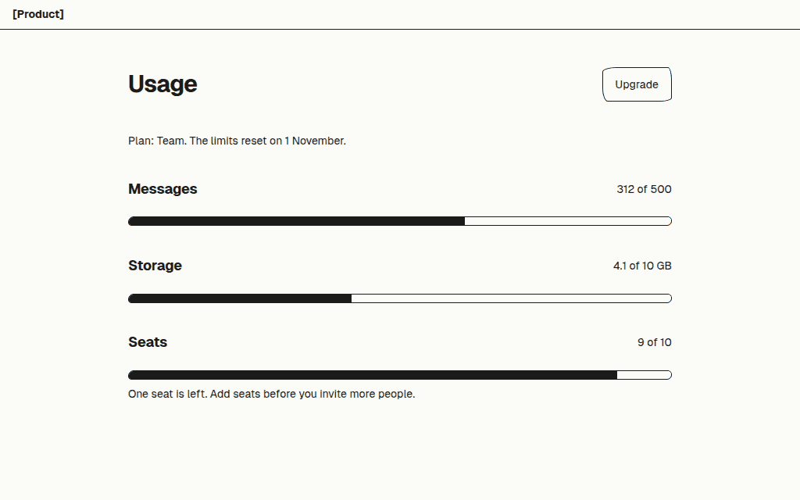</a></td>
<td><b>Usage meters</b> Limits and current use, such as messages, storage or seats. <a href="../templates/settings/usage-meters.html"><code>templates/settings/usage-meters.html</code></a></td>
</tr>
</table>

## Landing

<table>
<tr>
<td width="460"><a href="templates/landing/product-story.png">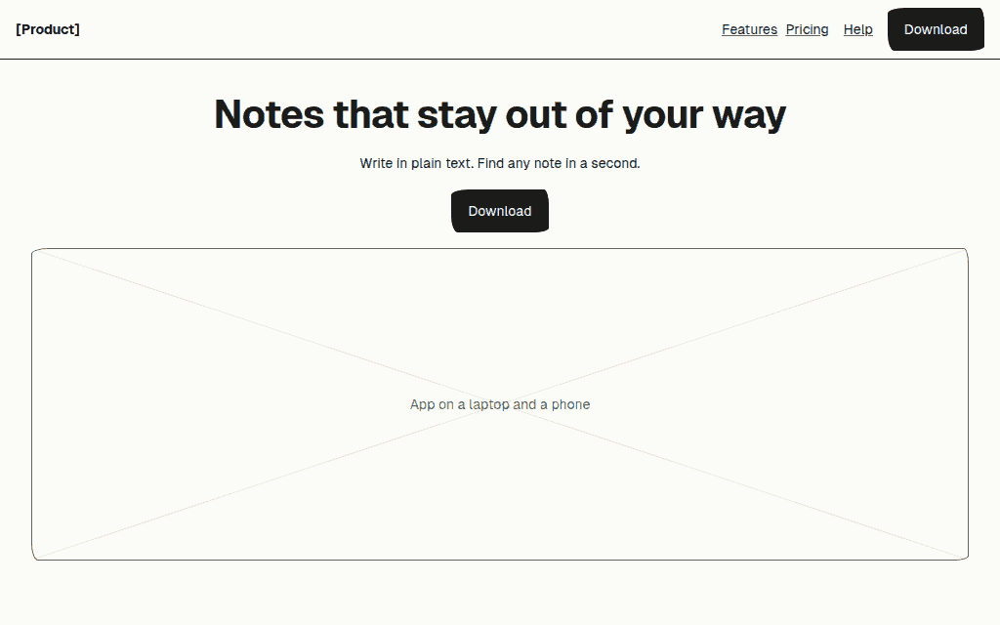</a></td>
<td><b>Product story</b> A public page that explains one product, with a hero, feature bands, prices and a footer. <a href="../templates/landing/product-story.html"><code>templates/landing/product-story.html</code></a></td>
</tr>
</table>

## Notes

<table>
<tr>
<td width="460"><a href="templates/notes/empty-editor.png">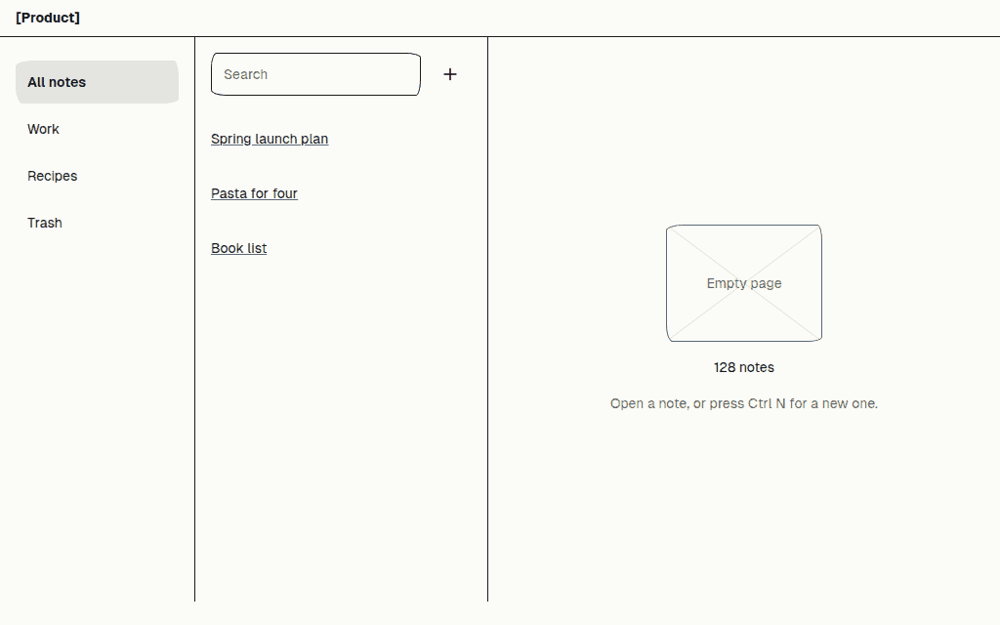</a></td>
<td><b>Empty editor</b> A writing tool before people open or make an item, with the list beside an empty editor. <a href="../templates/notes/empty-editor.html"><code>templates/notes/empty-editor.html</code></a></td>
</tr>
<tr>
<td width="460"><a href="templates/notes/three-columns.png">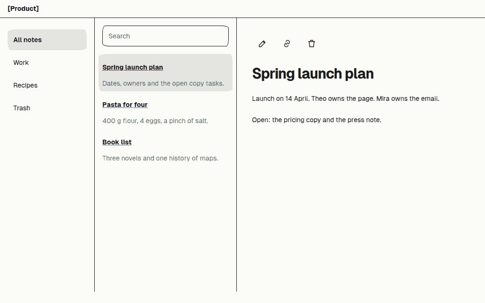</a></td>
<td><b>Three columns</b> A writing or mail tool with folders, a list of items with previews and one open item. <a href="../templates/notes/three-columns.html"><code>templates/notes/three-columns.html</code></a></td>
</tr>
</table>

## Detail

<table>
<tr>
<td width="460"><a href="templates/detail/properties-panel.png">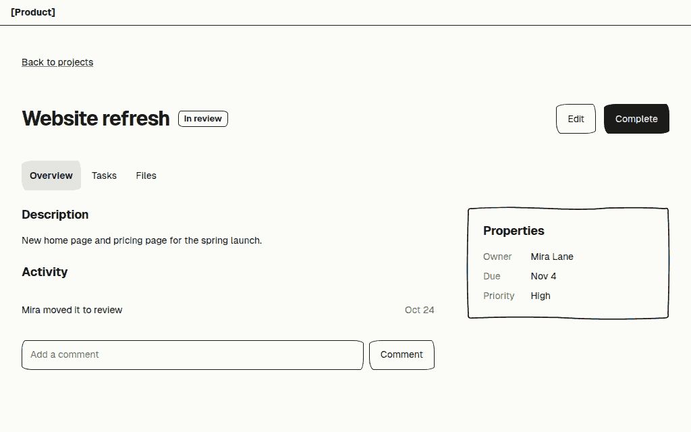</a></td>
<td><b>Properties panel</b> One record with a description, some properties and recent activity, such as a task, a ticket or a deal. <a href="../templates/detail/properties-panel.html"><code>templates/detail/properties-panel.html</code></a></td>
</tr>
</table>

## Form

<table>
<tr>
<td width="460"><a href="templates/form/single-column.png">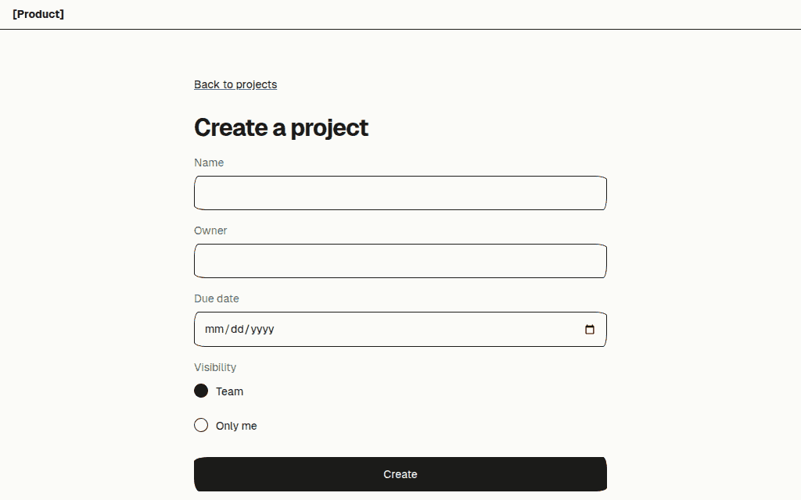</a></td>
<td><b>Single column</b> A short form that people complete once, such as a new project or a contact request. <a href="../templates/form/single-column.html"><code>templates/form/single-column.html</code></a></td>
</tr>
</table>

## Dashboard

<table>
<tr>
<td width="460"><a href="templates/dashboard/metrics.png">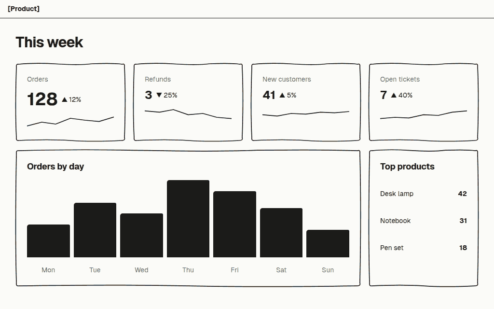</a></td>
<td><b>Metrics</b> A first page that shows a small number of key numbers and one chart, such as sales or sign-ups. <a href="../templates/dashboard/metrics.html"><code>templates/dashboard/metrics.html</code></a></td>
</tr>
</table>

## Board

<table>
<tr>
<td width="460"><a href="templates/board/kanban.png">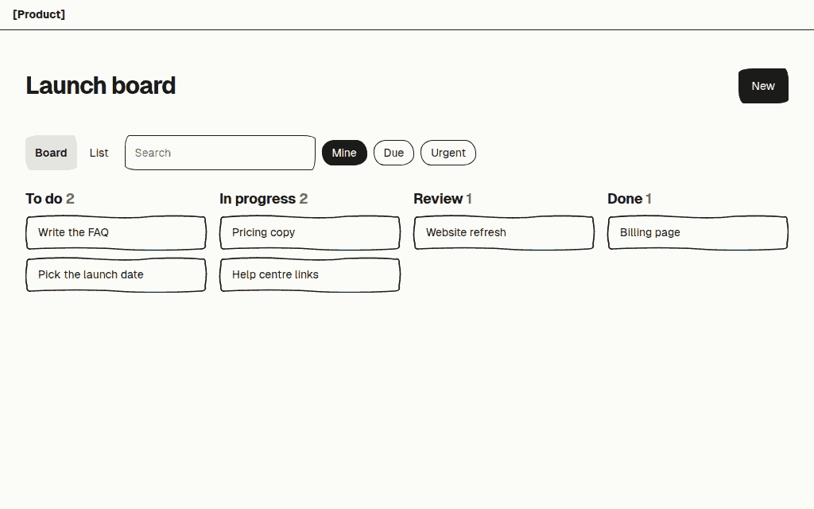</a></td>
<td><b>Kanban</b> Items that move through a small number of stages, such as tasks, leads or job applicants. <a href="../templates/board/kanban.html"><code>templates/board/kanban.html</code></a></td>
</tr>
</table>

## Checkout

<table>
<tr>
<td width="460"><a href="templates/checkout/one-page.png">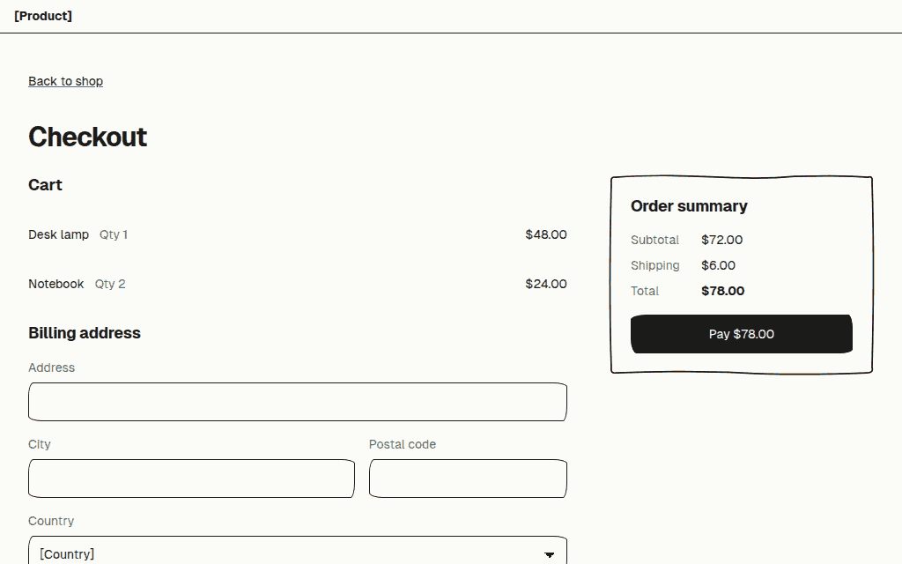</a></td>
<td><b>One page</b> A purchase of a small number of items, with the address, the payment and the order summary on one page. <a href="../templates/checkout/one-page.html"><code>templates/checkout/one-page.html</code></a></td>
</tr>
</table>

## Pricing

<table>
<tr>
<td width="460"><a href="templates/pricing/plans.png">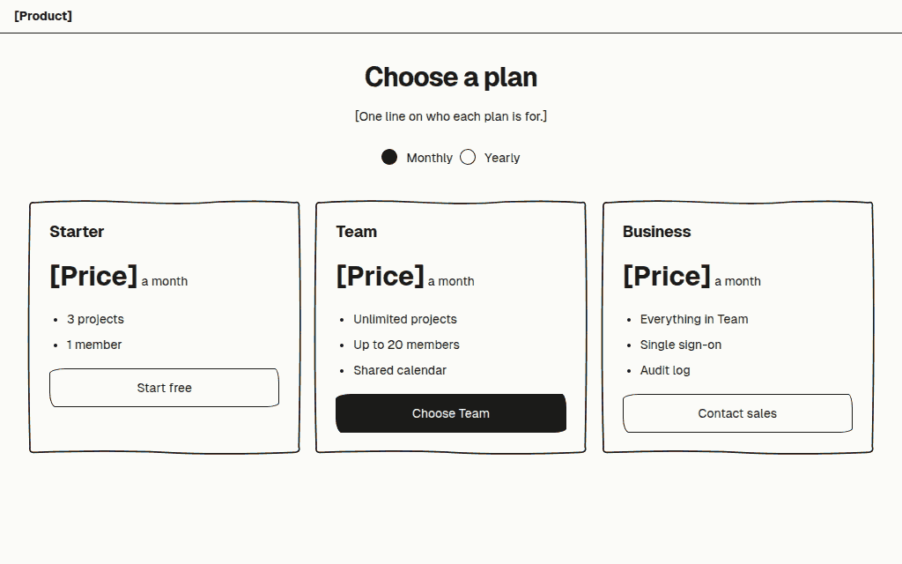</a></td>
<td><b>Plans</b> A public page that compares two or three plans and their prices. <a href="../templates/pricing/plans.html"><code>templates/pricing/plans.html</code></a></td>
</tr>
</table>

## Sign in

<table>
<tr>
<td width="460"><a href="templates/sign-in/email.png">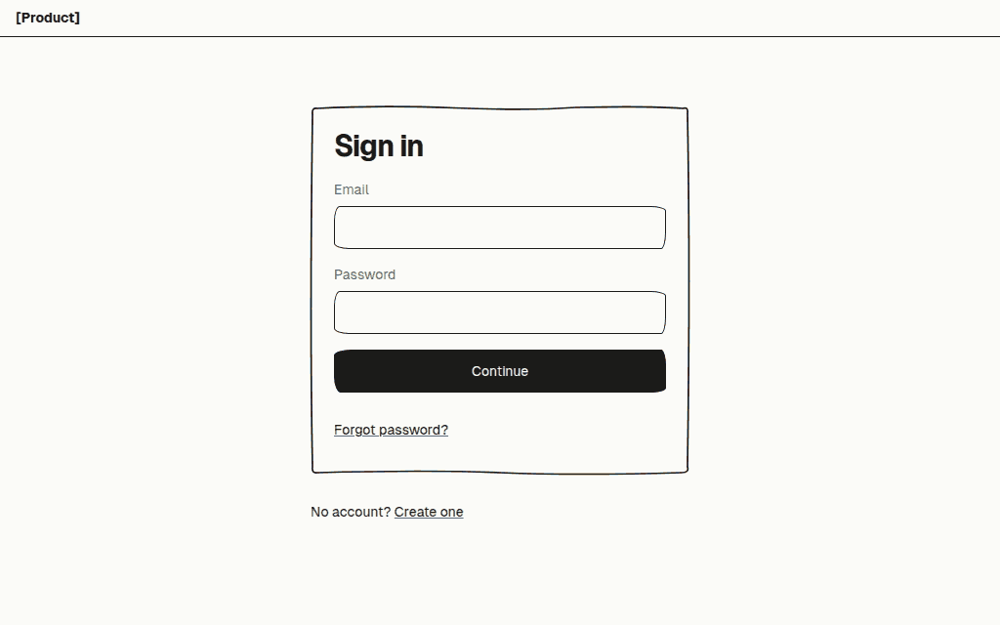</a></td>
<td><b>Email</b> A sign-in with an email address and a password. <a href="../templates/sign-in/email.html"><code>templates/sign-in/email.html</code></a></td>
</tr>
</table>

## Onboarding

<table>
<tr>
<td width="460"><a href="templates/onboarding/checklist.png">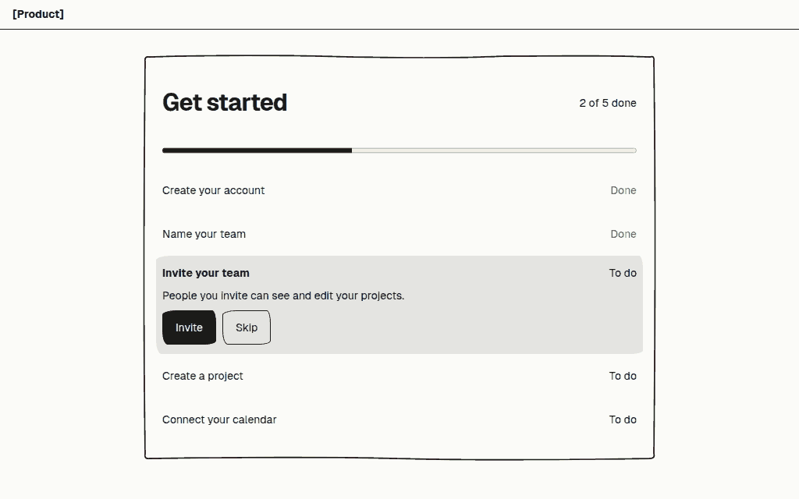</a></td>
<td><b>Checklist</b> A product that people set up over time, with a list of tasks and the tasks that are done. <a href="../templates/onboarding/checklist.html"><code>templates/onboarding/checklist.html</code></a></td>
</tr>
<tr>
<td width="460"><a href="templates/onboarding/steps.png">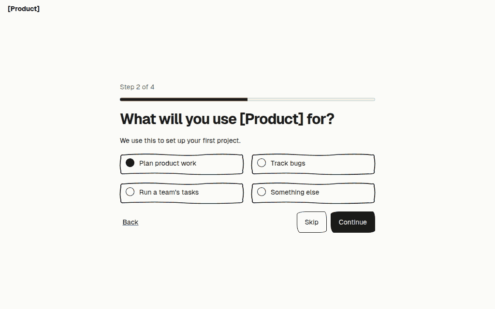</a></td>
<td><b>Steps</b> A setup that needs a small number of steps in a fixed order before people can use the product. <a href="../templates/onboarding/steps.html"><code>templates/onboarding/steps.html</code></a></td>
</tr>
<tr>
<td width="460"><a href="templates/onboarding/welcome.png">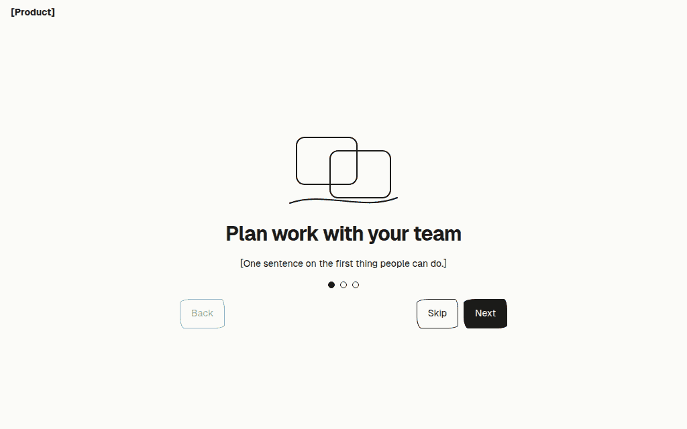</a></td>
<td><b>Welcome</b> The first start of an app, with a short welcome and one picture for each step. <a href="../templates/onboarding/welcome.html"><code>templates/onboarding/welcome.html</code></a></td>
</tr>
</table>

## Empty

<table>
<tr>
<td width="460"><a href="templates/empty/full-screen.png">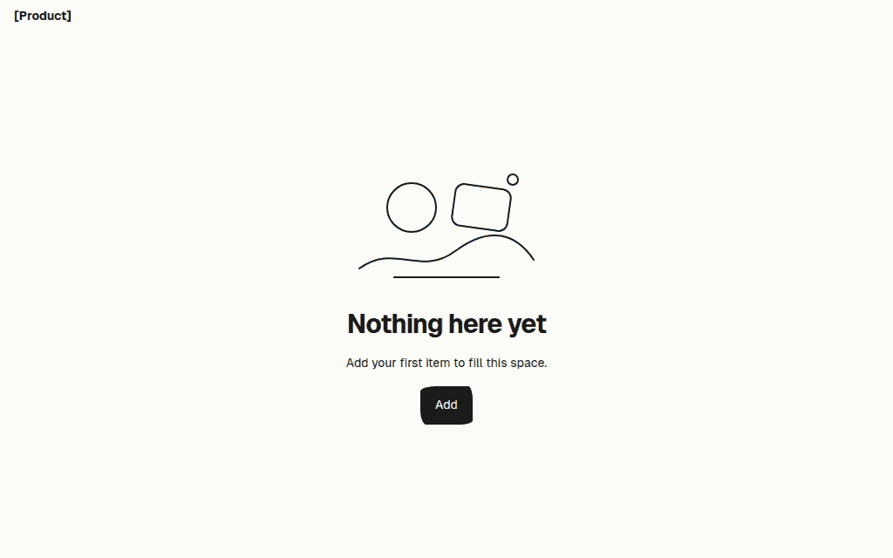</a></td>
<td><b>Full screen</b> A product or a section that has no data yet, with one action that starts it. <a href="../templates/empty/full-screen.html"><code>templates/empty/full-screen.html</code></a></td>
</tr>
</table>

## Mobile

<table>
<tr>
<td width="460"><a href="templates/mobile/tab-bar.png">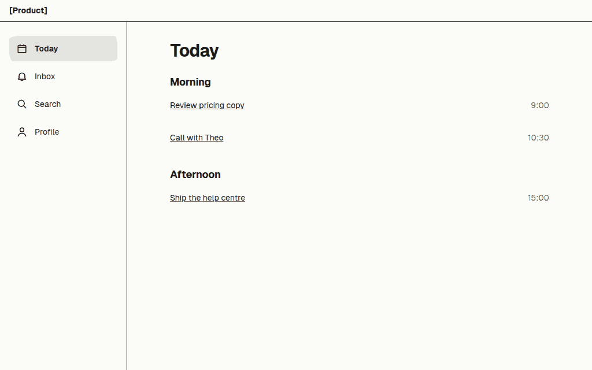</a></td>
<td><b>Tab bar</b> A phone app with 3 to 5 main sections that people switch between with one tap. <a href="../templates/mobile/tab-bar.html"><code>templates/mobile/tab-bar.html</code></a></td>
</tr>
</table>
